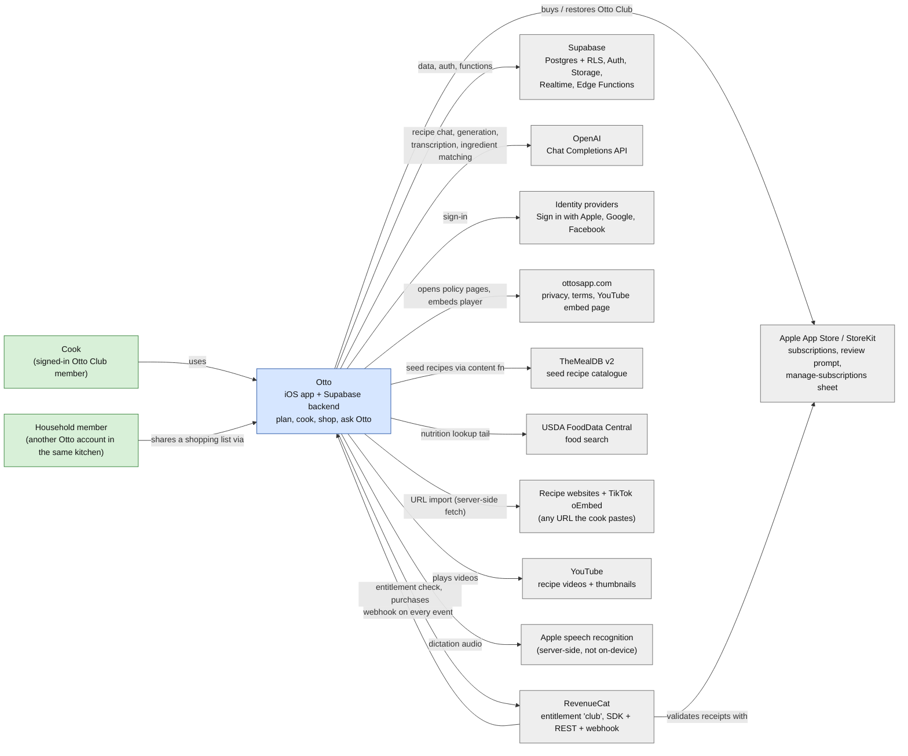
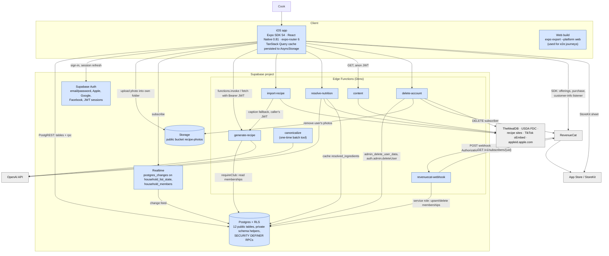
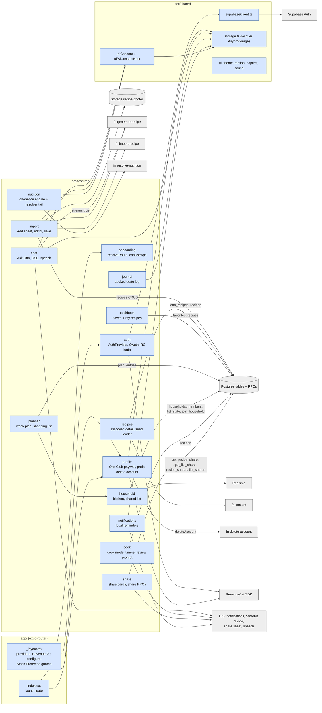
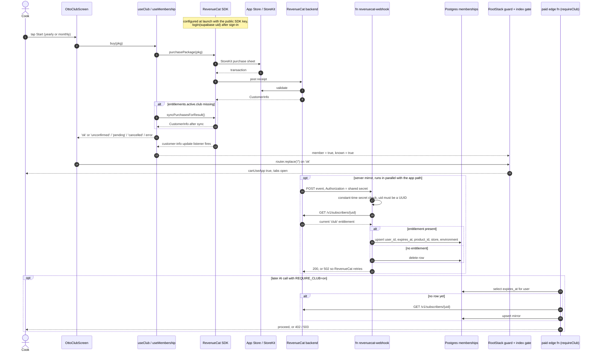
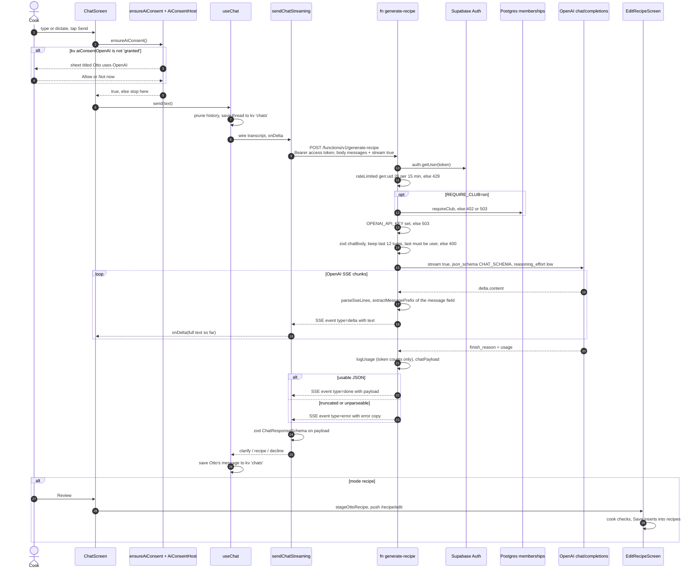

# Otto — C4 model

Status: current · Last verified at commit `0cbfaa9f` · 2026-11-04

This is the [C4 model](https://c4model.com) (Simon Brown) for Otto, drawn as
Mermaid flowcharts and sequence diagrams so GitHub renders them. Every fact
below comes from the code and cites `path:line`. Where a comment in the code
disagrees with the code, the code wins and the comment is listed under
[Open questions](EDGE_FUNCTIONS.md#open-questions--risks).

Colour key used in all flowcharts: **blue** = Otto (ours), **grey** = an
external system, **green** = a person.

---

## Level 1 — System context

Supabase is drawn as external at Level 1 because it is a hosted platform; at
Level 2 its pieces are Otto's own containers.

### Key facts

- There is no app server of our own: the app talks to Supabase directly with the
  anon key and the user's session (`src/shared/supabase/client.ts:28-39`).
- Every AI call is server-side, to `https://api.openai.com/v1/chat/completions`
  (`supabase/functions/_shared/openai.ts:5`), with strict `json_schema` output
  (`supabase/functions/_shared/openai.ts:29`). Models: `gpt-5.1`
  (`supabase/functions/generate-recipe/index.ts:14-15`,
  `supabase/functions/canonicalize/index.ts:20`) and `gpt-5-mini`
  (`supabase/functions/resolve-nutrition/index.ts:21`). No Anthropic/Claude call
  exists in the code.
- RevenueCat is configured once at module scope with a public App Store SDK key
  (`app/_layout.tsx:56`, key constant at `src/features/profile/club.purchases.ts:31`).
  The RevenueCat app user id is the Supabase uid (`src/features/auth/AuthProvider.tsx:93`).
- Sign-in: Apple uses the native sheet plus `signInWithIdToken`
  (`src/features/auth/oauth.native.ts:25-51`); Google uses the native Google SDK
  plus `signInWithIdToken` (`src/features/auth/oauth.native.ts:97-109`); Facebook
  uses Supabase OAuth in an ephemeral browser session
  (`src/features/auth/oauth.native.ts:57-83`, routed at
  `src/features/auth/auth.queries.ts:116-122`). Email/password also exists
  (`src/features/auth/auth.queries.ts:20`, `:30`).
- ottosapp.com serves the privacy policy (`src/shared/aiConsent.logic.ts:39`), the
  terms (`src/features/auth/components/AuthScreenLayout.tsx:82`) and the YouTube
  player page the app loads in a WebView (`src/features/recipes/components/VideoEmbed.tsx:30`).
- TheMealDB is reached only through the `content` edge function, so its key never
  ships in the app (`supabase/functions/content/index.ts:1-4`, `:14-15`).
- URL import fetches arbitrary pages server-side behind an SSRF guard
  (`supabase/functions/import-recipe/index.ts:68-142`) and calls TikTok's oEmbed API
  (`supabase/functions/import-recipe/index.ts:243-255`).
- Dictation uses `expo-speech-recognition`; the audio goes to Apple's speech
  service, not on-device (`src/features/chat/useSpeechInput.ts:5-10`).
- Sign in with Apple tokens are revoked at `appleid.apple.com` on account deletion
  (`supabase/functions/delete-account/index.ts:94-126`).
- The App Store review prompt is `expo-store-review`
  (`src/features/cook/reviewPrompt.ts:22-24`); reminders are local notifications
  only (`src/features/notifications/notifications.queries.ts:52`), so there is no
  push service.

---

## Level 2 — Containers

### Key facts

- **iOS app.** Bundle `com.otto.recipes`, Sign in with Apple enabled (`app.json`
  `expo.ios.bundleIdentifier`, `expo.ios.usesAppleSignIn`). The provider stack is
  gesture root, error boundary, safe area, persisted TanStack Query, auth, then the
  route stack (`app/_layout.tsx:63-98`). The query cache persists to AsyncStorage
  for a week and is cleared when the user changes (`app/_layout.tsx:29-51`).
- **Web build.** `npm run build:web` runs `expo export --platform web`
  (`package.json` `scripts.build:web`), with `web.bundler: metro` in `app.json`.
  The e2e journeys target the Expo web app on :8081
  (`e2e/journeys/import.ts:3-7`). Web gets its own OAuth path
  (`src/features/auth/auth.queries.ts:124-126`) and session-in-URL detection
  (`src/shared/supabase/client.ts:36`).
- **Postgres + RLS.** 12 tables survive the migrations; RLS is enabled on all of
  them. Full detail in [ERD.md](ERD.md).
- **Auth.** Session stored in AsyncStorage with auto refresh, paused while the app
  is backgrounded (`src/shared/supabase/client.ts:32-50`).
- **Storage.** One public bucket `recipe-photos`
  (`supabase/migrations/20260721090010_storage_policies.sql:19-21`). The client
  uploads to `<uid>/<uuid>.<ext>` (`src/features/import/import.queries.ts:161-165`).
  Only an INSERT-own-folder policy exists; deletes are service-role only
  (`supabase/migrations/20260721090010_storage_policies.sql:29-35`).
- **Realtime.** `household_list_state` and `household_members` are in the
  `supabase_realtime` publication
  (`supabase/migrations/20260722120000_households_shared_shopping_list.sql:70-71`);
  the app subscribes in `src/features/household/useHousehold.ts:72` and `:140`
  and only invalidates queries on a change.
- **Edge Functions.** Seven, documented one by one in
  [EDGE_FUNCTIONS.md](EDGE_FUNCTIONS.md). Shared helpers: JWT check
  (`supabase/functions/_shared/http.ts:23-34`), service-role client (`:36-41`),
  Otto Club gate (`:55-94`), in-memory rate limiter (`:99-110`).
- **RevenueCat webhook path.** RevenueCat posts to `revenuecat-webhook`, which
  checks a shared secret in constant time
  (`supabase/functions/revenuecat-webhook/index.ts:30-50`), re-reads the
  subscriber's current entitlement from RevenueCat rather than trusting the event
  (`:58-68`), and upserts or deletes the `memberships` row (`:80-100`).
  `memberships` is read only by the server-side gate `requireClub`
  (`supabase/functions/_shared/http.ts:58-63`); the app never queries it.
- **Server-side paywall switch.** `requireClub` does nothing unless the env var
  `REQUIRE_CLUB` is exactly `on` (`supabase/functions/_shared/membership.ts:15-17`,
  `supabase/functions/_shared/http.ts:56`). It guards `generate-recipe`,
  `import-recipe` and `resolve-nutrition`.

---

## Level 3 — Components (the app)

Feature modules live in `src/features/*`; each owns its screens, hooks and a
`*.queries.ts` file for server I/O. Routes in `app/` are thin re-exports
(for example `app/otto-club.tsx` re-exports `OttoClubScreen`).

`ui` is used by every screen; its edges are left out to keep the picture readable.

| Module | Talks to | Evidence |
|---|---|---|
| `auth` | Supabase Auth; RevenueCat `logIn`/`logOut`/`syncPurchasesForResult` | `src/features/auth/AuthProvider.tsx:51-61`, `:81-107`; `src/features/auth/auth.queries.ts:20-126` |
| `onboarding` | nothing remote: pure route decision + kv `onboarded` | `src/features/onboarding/gate.ts:23-35` |
| `profile` | RevenueCat SDK (offerings, purchase, restore, listener); `delete-account` fn | `src/features/profile/club.purchases.ts:49-163`; `src/features/profile/profile.queries.ts:8-13` |
| `chat` | `generate-recipe` (chat mode, SSE); kv `chats` for threads; speech recognition | `src/features/chat/chat.queries.ts:117-184`; `src/features/chat/useChat.ts:62`; `src/features/chat/useSpeechInput.ts:24-30` |
| `import` | `import-recipe`; `generate-recipe` (`{text}`, `{image}`, `{prompt}`); `recipes` CRUD; Storage upload | `src/features/import/import.queries.ts:43-106`, `:140-170`, `:209-275` |
| `recipes` | `otto_recipes` (when `EXPO_PUBLIC_USE_OTTO_RECIPES=true`), else `content` fn; `recipes` | `src/features/recipes/canonical.transform.ts:23`; `src/features/recipes/seed.loader.ts:25-48`; `src/features/recipes/recipe.queries.ts:55`, `:106`, `:309` |
| `cookbook` | `favorites`, `recipes` | `src/features/cookbook/saved.queries.ts:24-52`; `src/features/cookbook/mine.queries.ts:50` |
| `planner` | `plan_entries`, `recipes`; household shared list | `src/features/planner/plan.queries.ts:18-116` |
| `household` | `households`, `household_members`, `household_list_state`, RPC `join_household`, Realtime | `src/features/household/household.queries.ts:44-208`; `src/features/household/useHousehold.ts:72`, `:140` |
| `cook` | `recipes`; StoreKit review prompt; journal | `src/features/cook/cook.queries.ts:40`; `src/features/cook/reviewPrompt.ts:22-24` |
| `nutrition` | on-device engine; `resolve-nutrition` only with consent already granted | `src/features/nutrition/nutrition.queries.ts:64-65`; `src/features/nutrition/resolve.queries.ts:31-57` |
| `share` | RPCs `get_recipe_share`/`get_list_share`; inserts into `recipe_shares`/`list_shares`; OS share sheet | `src/features/share/share.queries.ts:16-91`; `src/features/share/shareImage.native.ts:24` |
| `journal` | kv `journal` only (device-local) | `src/features/journal/useJournal.ts:7` |
| `notifications` | `expo-notifications` local schedule | `src/features/notifications/notifications.queries.ts:52` |
| shared `aiConsent` | kv `aiConsentOpenAI`; the sheet in `AiConsentHost` | `src/shared/aiConsent.ts:32`, `:46-51`; `app/_layout.tsx:90` |

### Key facts

- Route guarding is in one place: `Stack.Protected` with three guards (signed out,
  signed in, signed in **and** member) (`app/_layout.tsx:131-155`). The member guard
  is `canUseApp` (`src/features/onboarding/gate.ts:33-35`) fed by `useMembership`
  (`app/_layout.tsx:109-111`).
- Membership in the app comes **only** from the RevenueCat SDK's customer info and
  its update listener (`src/features/profile/club.purchases.ts:65-72`), via
  `hasClubEntitlement` = `entitlements.active.club`
  (`src/features/profile/club.logic.ts:4`, `:25-27`). It fails closed while
  RevenueCat has not switched to the signed-in user (`src/features/profile/club.logic.ts:57-63`,
  `src/features/auth/AuthProvider.tsx:76`).
- AI consent is asked on the person's own action (`ensureAiConsent`) in chat
  (`src/features/chat/ChatScreen.tsx:123`, `:147`) and import
  (`src/features/import/AddSheet.tsx:96`, `:117`, `:132`); background nutrition
  matching only checks silently (`src/features/nutrition/nutrition.queries.ts:64`).
  With no sheet mounted it fails closed (`src/shared/aiConsent.ts:49`).
- Exported but not used by any screen: `useCreateRecipeShare`,
  `useCreateListShare`, `useRecipeShare`, `useListShare`
  (only re-exported at `src/features/share/index.ts:8-11`), `useGenerateRecipe`
  (only at `src/features/import/index.ts:14`) and `sendChat` (the non-streaming
  chat call, `src/features/chat/chat.queries.ts:81`).

---

## Dynamic diagram (a) — buying Otto Club

The real flow has two independent paths after Apple charges: the **app gate**
(RevenueCat SDK → listener → route guard) and the **server mirror** (RevenueCat
webhook → `memberships` row → read by `requireClub` in the paid edge functions).
The app gate never reads `memberships`.

### Key facts

- Purchase: `onBuy` → `club.buy(pkg)` (`src/features/profile/OttoClubScreen.tsx:60-68`)
  → `Purchases.purchasePackage` (`src/features/profile/club.purchases.ts:112`); if
  RevenueCat has not granted `club`, one `syncPurchasesForResult` and re-check
  (`src/features/profile/club.purchases.ts:21-27`, `:113`). A charge without the
  entitlement returns `'unconfirmed'`, never success (`src/features/profile/club.purchases.ts:115`).
  An error path also syncs once in case the charge went through (`:121-123`).
- On `'ok'` the paywall replaces to `/` so the launch gate re-reads membership
  (`src/features/profile/OttoClubScreen.tsx:42-44`, `:64`); `resolveRoute` sends a
  member to `/(tabs)` (`src/features/onboarding/gate.ts:23-29`).
- The listener that flips the gate is `Purchases.addCustomerInfoUpdateListener`
  (`src/features/profile/club.purchases.ts:68-72`); the gate consumes it at
  `app/_layout.tsx:109-111` and `app/index.tsx:12-19`.
- After sign-in the app calls `Purchases.logIn(uid)` and, once per account per
  device, `syncPurchasesForResult` (`src/features/auth/AuthProvider.tsx:93-102`),
  with a 5 s ceiling so the splash cannot hang (`:92`).
- Webhook: POST only (`supabase/functions/revenuecat-webhook/index.ts:43`); secret
  accepted bare or as `Bearer <secret>` (`:48-49`); non-UUID `app_user_id`
  (anonymous RevenueCat ids) is acknowledged with 200 and ignored (`:54-56`);
  lifetime grants with no expiry are stored as `9999-12-31` (`:78`).
- `memberships` has only a select-own policy; all writes are service role
  (`supabase/migrations/20260723150000_memberships.sql:16-21`).
- The server gate also writes the mirror itself when RevenueCat confirms a member
  with no row yet (`supabase/functions/_shared/http.ts:67-89`). An expired row is a
  final no (`:65`). RevenueCat unreachable with no row is 503, not a free pass (`:68`, `:90-93`).

---

## Dynamic diagram (b) — Ask Otto chat

### Key facts

- Consent comes before the draft is cleared (`src/features/chat/ChatScreen.tsx:118-133`);
  the stored key names the provider (`src/shared/aiConsent.ts:32`), only an
  explicit `'granted'` lets data leave (`src/shared/aiConsent.logic.ts:18-20`).
- Transcripts are device-local: kv `chats`, at most 30 threads, 30 days
  (`src/features/chat/useChat.ts:47-66`). There is no chat table.
- The streaming call is a raw `expo/fetch` with the session token
  (`src/features/chat/chat.queries.ts:117-139`). If the server answers JSON (an old
  deploy) the client parses it as the non-streaming reply (`:146-151`). Frames are
  split by `feedSse` (`src/features/chat/sse.logic.ts:7-22`); `delta`, `done`,
  `error` handled at `src/features/chat/chat.queries.ts:167-174`; a stream that ends
  without `done` is an error (`:181-183`).
- Server order: method, JWT, rate limit, club gate, key present, then body
  (`supabase/functions/generate-recipe/index.ts:312-336`). Chat with `stream: true`
  goes to `streamChat` (`:342`, `:201-285`), which sends `delta` events for the
  growing `message` field (`:241-247`), then `done` with exactly the JSON-path
  payload or `error` (`:258-266`). Response header `content-type: text/event-stream`
  (`:283`).
- OpenAI is called with `stream: true` and `stream_options.include_usage`
  (`supabase/functions/_shared/openai.ts:31`), 120 s timeout
  (`supabase/functions/generate-recipe/index.ts:215`).
- `ChatScreen` calls `useChat({ threadId })` without `diet`/`cuisines`
  (`src/features/chat/ChatScreen.tsx:81`), so the server's context lines
  (`supabase/functions/generate-recipe/index.ts:297-307`) are empty for chat today.
- A `recipe` reply opens the editor for review; nothing is saved by the chat
  itself (`src/features/chat/ChatScreen.tsx:158-165`; save is `useSaveRecipe`,
  `src/features/import/import.queries.ts:335-347`).
