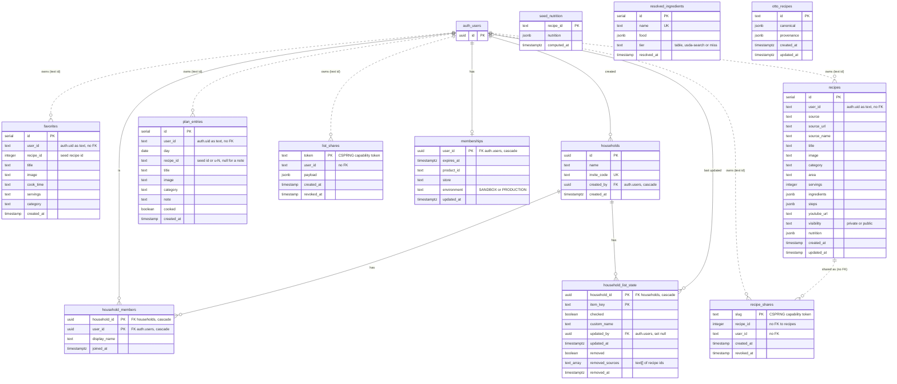

# Otto — data model (ERD)

Status: current · Last verified at commit `0cbfaa9f` · 2026-11-04

Built by reading `supabase/migrations/*.sql` in filename order (25 files,
`20260721090001` → `20260924234635`); the last statement that touches an object
wins. Migration file names are shortened below to their timestamp, so
`…/090009` means `supabase/migrations/20260721090009_share_functions.sql`.

**Final state: 12 tables in `public`, 2 helper functions in `private`, 4 callable
RPCs in `public`, 1 Storage bucket.** Two tables created early
(`collab_lists`, `collab_items`) were dropped
(`20260723120000_harden_security_definer_functions.sql:15-16`).

## Diagram

`auth_users` stands for Supabase's `auth.users`. Older tables keep the owner as a
`text` copy of `auth.uid()` with **no foreign key**; newer tables use a `uuid` FK
with `ON DELETE CASCADE`. Dashed relationships below are logical (no FK in the schema).

`seed_nutrition`, `resolved_ingredients` and `otto_recipes` are catalogue/cache
tables with no owner. `favorites.recipe_id` and `plan_entries.recipe_id` point at
seed catalogue ids (TheMealDB or `otto_recipes`) or user recipes by convention
only (`20260721090003_plan_entries.sql:7`).

## Storage

| Bucket | Public | Policies | Evidence |
|---|---|---|---|
| `recipe-photos` | yes (objects served by direct URL) | INSERT for `authenticated` only when the first path segment is `auth.uid()`; no SELECT (blocks listing), no UPDATE/DELETE (cleanup is service role in `delete-account`). The policy step is wrapped to skip with a NOTICE if the migration role lacks privilege, so it may have been created by hand. | `20260721090010_storage_policies.sql:19-39` |

## Data dictionary

Legend for **RLS**: S/I/U/D = select/insert/update/delete. "own" = the row's owner
column equals `auth.uid()`. "service" = no policy, so only the service role
(which bypasses RLS) can do it. Every table below has RLS enabled.
**PII** is marked yes for anything that identifies a person or is content they
wrote/uploaded.

### `favorites` — saved seed recipes

Created `20260721090001_favorites.sql:6-16`; unique `(user_id, recipe_id)` added
`20260723130000_favorites_unique_user_recipe.sql:5-6`.

| Column | Type | Null | Meaning | PII |
|---|---|---|---|---|
| id | serial PK | no | row id | no |
| user_id | text | no | owner, `auth.uid()` as text | yes |
| recipe_id | integer | no | seed recipe id | no |
| title | text | no | recipe title snapshot | no |
| image | text | yes | image URL snapshot | no |
| cook_time | text | yes | display text | no |
| servings | text | yes | display text | no |
| category | text | yes | display text | no |
| created_at | timestamp | yes | default `now()` | no |

RLS: S/I/U/D own, `to authenticated` (`20260721090001_favorites.sql:20-39`).

### `recipes` — the user's own recipes (imported, generated, written)

> **Migration (applied 2026-11-06):** `20261106042712_recipe_size.sql` adds `yield_qty numeric`, `yield_unit text`, `serving_unit text` (all nullable) for "1 loaf · 10 slices". The app writes them only when `EXPO_PUBLIC_FLOW_V2=true`.

Created `20260721090002_recipes.sql:5-23`; CHECK `visibility in ('private','public')` at `:26-31`.

| Column | Type | Null | Meaning | PII |
|---|---|---|---|---|
| id | serial PK | no | row id | no |
| user_id | text | no | owner | yes |
| source | text | no | origin: `imported`, `otto`, `manual` (`src/features/import/import.queries.ts:75`, `:88`, `:96`) | no |
| source_url | text | yes | page the recipe came from | no |
| source_name | text | yes | site or `@handle` credit | no |
| title | text | no | title | yes (user content) |
| image | text | yes | image URL, may be the user's uploaded photo | yes |
| category | text | yes | dish kind | no |
| area | text | yes | cuisine | no |
| servings | integer | yes | servings | no |
| ingredients | jsonb | no | `[{measure,name}]`, default `[]` | yes (user content) |
| steps | jsonb | no | `[string]`, default `[]` | yes (user content) |
| youtube_url | text | yes | video link | no |
| visibility | text | no | `private` (default) or `public` | no |
| nutrition | jsonb | yes | computed at save | no |
| created_at / updated_at | timestamp | yes | default `now()` | no |

RLS:
- S: own **or** a household co-member's (`private.shares_household`), `to authenticated`
  (`20260924225050_sb6_merge_duplicate_select_policies.sql:17-24`).
- I/U/D: own (`20260721090002_recipes.sql:40-54`).
- The v1 policy `"public recipes readable"` was dropped (`20260721090011_drop_legacy_v1_policies.sql:15`),
  so `visibility = 'public'` grants nothing at the table level today.

### `plan_entries` — the week planner

> **Migration (applied 2026-11-06):** `20261106042714_plan_list.sql` adds `position double precision`, `label text`, `kind text default 'recipe'` (recipe · food · leftover · note · out) and an index on `(user_id, day, position)`; it carries legacy `note='leftovers'` into `kind`. The app writes them only when `EXPO_PUBLIC_FLOW_V2=true`. Swap is now one `UPDATE` of the row on any schema.

Created `20260721090003_plan_entries.sql:3-14`.

| Column | Type | Null | Meaning | PII |
|---|---|---|---|---|
| id | serial PK | no | row id | no |
| user_id | text | no | owner | yes |
| day | date | no | planned day | no |
| recipe_id | text | yes | `"52772"` (seed) or `"u-12"` (user); null = note-only row | no |
| title | text | no | title snapshot | no |
| image | text | yes | image snapshot | no |
| category | text | yes | category snapshot | no |
| note | text | yes | free text | yes (user content) |
| cooked | boolean | no | default false | no |
| created_at | timestamp | yes | default `now()` | no |

RLS: S own or household co-member (`20260924225050_sb6_merge_duplicate_select_policies.sql:8-15`);
I/U/D own (`20260721090003_plan_entries.sql:23-37`).

### `seed_nutrition` — compute-once nutrition for seed recipes

Created `20260721090004_seed_nutrition.sql:6-10`.

| Column | Type | Null | Meaning | PII |
|---|---|---|---|---|
| recipe_id | text PK | no | seed id | no |
| nutrition | jsonb | no | engine output | no |
| computed_at | timestamptz | no | default `now()` | no |

RLS: S for `anon, authenticated` (`:14-17`); I/U/D service. No client code reads
this table today (only comments mention it, e.g. `src/features/recipes/canonical.transform.ts:87`).

### `recipe_shares` — public recipe links

Created `20260721090005_recipe_shares.sql:9-15`.

| Column | Type | Null | Meaning | PII |
|---|---|---|---|---|
| slug | text PK | no | capability token, minted client-side from a CSPRNG (`src/features/share/token.ts:15`) | no |
| recipe_id | integer | no | `recipes.id` (no FK) | no |
| user_id | text | no | owner | yes |
| created_at | timestamp | yes | default `now()` | no |
| revoked_at | timestamp | yes | set = link dead (410) | no |

RLS: S/D own (`:19-22`, `:52-55`); I and U own **and** the recipe must belong to
the caller (`:24-33`, `:40-50`). No anon SELECT; anon reads go through
`get_recipe_share`.

### `list_shares` — shopping-list snapshots behind a link

Created `20260721090006_list_shares.sql:6-12`.

| Column | Type | Null | Meaning | PII |
|---|---|---|---|---|
| token | text PK | no | capability token | no |
| user_id | text | no | owner | yes |
| payload | jsonb | no | the list snapshot | yes (user content) |
| created_at | timestamp | yes | default `now()` | no |
| revoked_at | timestamp | yes | set = link dead | no |

RLS: S/I/U/D own (`:16-35`). Anon reads only via `get_list_share`.

### `resolved_ingredients` — durable AI-resolver cache

Created `20260721090008_resolved_ingredients.sql:6-12`.

| Column | Type | Null | Meaning | PII |
|---|---|---|---|---|
| id | serial PK | no | row id | no |
| name | text, unique | no | lowercased ingredient name | no (but it is free text a user typed) |
| food | jsonb | yes | per-100 g USDA row, null = miss | no |
| tier | text | no | `"table"`, `"usda-search"` or `"miss"` | no |
| resolved_at | timestamp | yes | default `now()` | no |

RLS: S for `anon, authenticated` (`:16-19`); writes service only, done by
`resolve-nutrition` (`supabase/functions/resolve-nutrition/index.ts:219-223`).

### `otto_recipes` — Otto's own recipe catalogue (serving copy)

Created `20260723140000_otto_recipes.sql:6-12`.

| Column | Type | Null | Meaning | PII |
|---|---|---|---|---|
| id | text PK | no | recipe id (TheMealDB ids and Otto originals 900001+, `src/features/recipes/seed.loader.ts:9`) | no |
| canonical | jsonb | no | the canonical "silver" record | no |
| provenance | jsonb | no | source/media provenance | no |
| created_at / updated_at | timestamptz | no | default `now()` | no |

RLS: S for `anon, authenticated` (`:16-19`); writes service only, by
`tools/deploy-recipes.mjs` (`tools/deploy-recipes.mjs:4-8`). Read by the app when
`EXPO_PUBLIC_USE_OTTO_RECIPES=true` (`src/features/recipes/canonical.transform.ts:23`,
`src/features/recipes/recipe.queries.ts:55`, `src/features/recipes/seed.loader.ts:33-41`).

### `memberships` — server mirror of Otto Club

Created `20260723150000_memberships.sql:7-14`.

| Column | Type | Null | Meaning | PII |
|---|---|---|---|---|
| user_id | uuid PK, FK `auth.users` ON DELETE CASCADE | no | the member | yes |
| expires_at | timestamptz | no | active while `> now()`; lifetime grants = `9999-12-31` | no |
| product_id | text | yes | store product id | no |
| store | text | yes | store name from the webhook event | no |
| environment | text | yes | `SANDBOX` or `PRODUCTION` | no |
| updated_at | timestamptz | no | default `now()` | no |

RLS: S own, `to authenticated` (`:18-21`); I/U/D service only. Writers:
`revenuecat-webhook` (`supabase/functions/revenuecat-webhook/index.ts:83`, `:88-95`)
**and** `requireClub` (`supabase/functions/_shared/http.ts:80-87`). Reader:
`requireClub` only (`supabase/functions/_shared/http.ts:58-63`); the app does not
read it.

### `households` — a kitchen that shares a shopping list

Created `20260722120000_households_shared_shopping_list.sql:3-9`; index on
`created_by` `20260725140000_household_fk_covering_indexes.sql:10-11`.

| Column | Type | Null | Meaning | PII |
|---|---|---|---|---|
| id | uuid PK | no | `gen_random_uuid()` | no |
| name | text | no | default `'Our kitchen'` | no |
| invite_code | text, unique | no | 6 chars from a 32-char alphabet, made with `Math.random` (`src/features/household/household.queries.ts:33-39`) | no |
| created_by | uuid FK `auth.users` ON DELETE CASCADE | no | creator | yes |
| created_at | timestamptz | no | default `now()` | no |

RLS: S creator or member (`20260924225011_sb6_rls_initplan_optimization.sql:36-42`);
I creator only (`:31-34`); **no U/D policy** (rename/delete impossible from the client).

### `household_members`

Created `20260722120000_households_shared_shopping_list.sql:11-17`; index on
`user_id` `20260725140000_household_fk_covering_indexes.sql:8-9`.

| Column | Type | Null | Meaning | PII |
|---|---|---|---|---|
| household_id | uuid, PK part, FK `households` ON DELETE CASCADE | no | kitchen | no |
| user_id | uuid, PK part, FK `auth.users` ON DELETE CASCADE | no | member | yes |
| display_name | text | yes | name shown to the kitchen | yes |
| joined_at | timestamptz | no | default `now()` | no |

RLS:
- S: members of the same household (`20260723120000_harden_security_definer_functions.sql:51-53`).
- I: self, and only into a household you created (`20260924225011_sb6_rls_initplan_optimization.sql:10-20`);
  everyone else joins through `join_household`.
- U: own row, while still a member (`:22-29`). D: own row (leave) (`:5-8`).
- In the Realtime publication (`20260722120000_households_shared_shopping_list.sql:71`).

### `household_list_state` — shared check-offs and removals

Created `20260722120000_households_shared_shopping_list.sql:19-27`; `removed`,
`removed_sources` added `20260725120000_household_list_removals.sql:9-11`;
`removed_at` added `20260725130000_household_list_removed_at.sql:5-6`; index on
`updated_by` `20260725140000_household_fk_covering_indexes.sql:6-7`.

| Column | Type | Null | Meaning | PII |
|---|---|---|---|---|
| household_id | uuid, PK part, FK `households` ON DELETE CASCADE | no | kitchen | no |
| item_key | text, PK part | no | normalized list-item key | no |
| checked | boolean | no | default false | no |
| custom_name | text | yes | hand-added item name | yes (user content) |
| updated_by | uuid FK `auth.users` ON DELETE SET NULL | yes | last writer | yes |
| updated_at | timestamptz | no | default `now()` | no |
| removed | boolean | no | default false; hand-removed row | no |
| removed_sources | text[] | yes | recipe ids the removed amount came from | no |
| removed_at | timestamptz | yes | when removed | no |

RLS: one `FOR ALL` policy, members only (`20260723120000_harden_security_definer_functions.sql:46-49`).
In the Realtime publication (`20260722120000_households_shared_shopping_list.sql:70`).

### `app_events` — product interaction events (R0.8)
Migration `20261106050937_app_events.sql` (applied 2026-11-06). `id` identity, `user_id uuid not null → auth.users on delete cascade`, `device_id text` (8–64), `name text` (`^[a-z][a-z0-9_]{2,40}$`), `props jsonb` (≤ 2 KB), `app_version`, `occurred_at`, `created_at`. RLS: insert own row only (`user_id = auth.uid()`); no select/update/delete policy, so clients read nothing. Written in batches by `src/shared/track.ts`; event names and props in `src/shared/events.ts` and `docs/product/TRACKING_PLAN.md`.

### `shopping_lists` — the personal list's state on the account (R0.11)
Migration `20261106213429_shopping_lists.sql` (applied 2026-11-06). `user_id uuid pk → auth.users on delete cascade`, `state jsonb` (the kv `shoppingState` blob: ticks, extras, dropped dishes, removed rows; ≤ 64 KB), `saved_at timestamptz`. RLS: select, insert and update own row. Under flowV2 every save mirrors up and opening the list takes the newer copy (`shopping.store.ts`). A shared kitchen's list stays in `household_list_state`.

### `agent_actions` — what Otto did, and how to undo it (R0.13)
Migration `20261106213056_agent_actions_ai_consent.sql` (applied 2026-11-06). `id bigint identity pk`, `user_id uuid → auth.users on delete cascade` (default `auth.uid()`), `idempotency_key text` (unique per user: a retried model call can't act twice), `action text` (the action catalogue name), `input jsonb`, `inverse jsonb` (replayed by Undo), `summary text` (the "Otto did" line), `created_at`, `undone_at`. RLS: select and insert own; update own, and only the `undone_at` column is granted. Written by the agent edge function (1.2) with the person's token. Nothing writes it yet.

### `profiles` — food preferences on the account (R0.4, ADR-0010)
Migration `20261106140640_profiles.sql` (applied 2026-11-06). `user_id uuid pk → auth.users on delete cascade`, `household jsonb` ({adults, kids}), `diet` (none · vegetarian · vegan), `allergies text[]` (≤ 9), `skips text[]` (≤ 12), `cuisines text[]`, `updated_at`, and since R0.13 `ai_consent` (granted · declined), `ai_consent_provider`, `ai_consent_at`. RLS: select, insert and update own row. The app syncs it under flowV2 (`usePrefs` → `profile.queries`), kv as the offline cache.

### `household_join_attempts` — join tries (A2)
Migration `20261106050413_household_join_attempts.sql` (applied 2026-11-06). `user_id → auth.users on delete cascade`, `at`. RLS on, no policies: only `join_household` (SECURITY DEFINER) writes it, to allow 10 tries per 15 minutes.

### Dropped tables

| Table | Created | Dropped |
|---|---|---|
| `collab_lists` | `20260721090007_collab_lists.sql:12-17` | `20260723120000_harden_security_definer_functions.sql:16` |
| `collab_items` | `20260721090007_collab_lists.sql:19-28` | `20260723120000_harden_security_definer_functions.sql:15` |

## Functions (RPCs and SECURITY DEFINER helpers)

| Function | Kind | Callable by | What it does | Final definition |
|---|---|---|---|---|
| `public.get_recipe_share(p_slug text)` → `(status, recipe jsonb)` | SQL, SECURITY DEFINER, `search_path = ''`, stable | anon, authenticated, service_role | One share by exact slug: `ok`/`revoked`/`missing`; recipe JSON with `user_id` stripped | `20260721090009_share_functions.sql:14-38`; comment `20260924214553_document_security_definer_functions.sql:12-17` |
| `public.get_list_share(p_token text)` → `(status, payload jsonb)` | SQL, SECURITY DEFINER, `search_path = ''`, stable | anon, authenticated, service_role | One list snapshot by exact token; `ok`/`revoked` | `20260721090009_share_functions.sql:41-56`; comment `20260924214615_correct_list_share_comment.sql:1-6` |
| `public.join_household(code text)` → `uuid` | plpgsql, SECURITY DEFINER, `search_path = public` | authenticated | Looks up `upper(trim(code))`, inserts the caller as a member, returns the household id; raises `No kitchen with that code` | `20260722120000_households_shared_shopping_list.sql:59-68`, grants `:76-78` |
| `public.admin_delete_user_data(p_user_id text)` → `void` | plpgsql, SECURITY DEFINER, `search_path = ''` | service_role only | One transaction deleting the user's `favorites`, `recipes`, `plan_entries`, `recipe_shares`, `list_shares` | `20260924234635_fix_admin_delete_user_data_drop_collab.sql:9-22`; grant from `20260721090009_share_functions.sql:205-206` (kept by `create or replace`) |
| `private.is_household_member(hid uuid)` → `boolean` | SQL, SECURITY DEFINER, `search_path = public` | authenticated, service_role (schema not exposed by PostgREST) | RLS helper: is `auth.uid()` in this household | `20260723120000_harden_security_definer_functions.sql:22-28`, `:40-43` |
| `private.shares_household(other uuid)` → `boolean` | SQL, SECURITY DEFINER, `search_path = public` | authenticated, service_role | RLS helper: do the caller and `other` share any household | `20260723120000_harden_security_definer_functions.sql:30-38`, `:40-43` |

Dropped: `get_collab_list`, `add_collab_item`, `set_collab_item_checked`,
`delete_collab_item` (`20260723120000_harden_security_definer_functions.sql:11-14`)
and the original `public.is_household_member` / `public.shares_household`
(`:73-74`).

Account deletion does not need lines for `memberships`, `households`,
`household_members`: they cascade from `auth.users` when `delete-account`
deletes the login last (`20260924234635_fix_admin_delete_user_data_drop_collab.sql:1-8`).
Because `households.created_by` cascades, **deleting the creator deletes the whole
kitchen for every member** (`20260722120000_households_shared_shopping_list.sql:7`).

## Cross-check against `src/types/database.ts`

`src/types/database.ts` says it was regenerated on 2026-07-23 after the
`otto_recipes` migration (`src/types/database.ts:5-8`).

| Finding | Evidence |
|---|---|
| **`memberships` is missing from the generated types.** The table was created by the very next migration (`20260723150000`), after the last regeneration. No client code queries it, so nothing breaks today, but `supabase.from('memberships')` would be untyped. | `src/types/database.ts:24-371` has no `memberships`; `20260723150000_memberships.sql:7` |
| All other 11 tables match the final migration state column for column, including the later `removed`, `removed_sources`, `removed_at` columns. | `src/types/database.ts:61-104` |
| The 4 public functions match (`admin_delete_user_data`, `get_list_share`, `get_recipe_share`, `join_household`); the dropped collab RPCs are absent, as they should be. | `src/types/database.ts:375-395` |
| `recipes.visibility` is typed `string`; the CHECK constraint (`private`/`public`) is not reflected. Normal for generated types. | `src/types/database.ts:286`; `20260721090002_recipes.sql:26-31` |
| FKs to `auth.users` are not listed in `Relationships` (only FKs inside `public` are). Normal for generated types. | `src/types/database.ts:95-103`, `:124-132` |
| The header points at `docs/contracts/database.md`; the file lives at `docs/reference/contracts/database.md`. | `src/types/database.ts:2` |

## Other observations

- Owner columns are inconsistent: `text` with no FK on the five v1-era tables,
  `uuid` FK on the household and membership tables. Household-read policies cast
  `user_id::uuid` (`20260924225050_sb6_merge_duplicate_select_policies.sql:14`, `:23`).
- Timestamps mix `timestamp` (v1 tables) and `timestamptz` (newer tables), as
  the old contract allowed.
- `recipe_shares.recipe_id` has no FK; `get_recipe_share` reports `missing` when
  the recipe is gone (`20260721090009_share_functions.sql:24`, `:33`).
- `join_household` and the two `private` helpers use `search_path = public`,
  unlike the share functions' empty `search_path`.
- The RLS attack suite (`supabase/migrations/tests/rls-attacks.test.mjs`) covers
  cross-user CRUD on owner tables, households, `memberships` self-grant
  (`:216`), anon enumeration (`:226`), the share RPCs (`:250-258`) and
  `admin_delete_user_data` denial (`:267`). It runs against the live project and
  is **not** in `npm test` (the glob covers `supabase/functions/**`, not
  `supabase/migrations/**`; `package.json` `scripts.test`).
